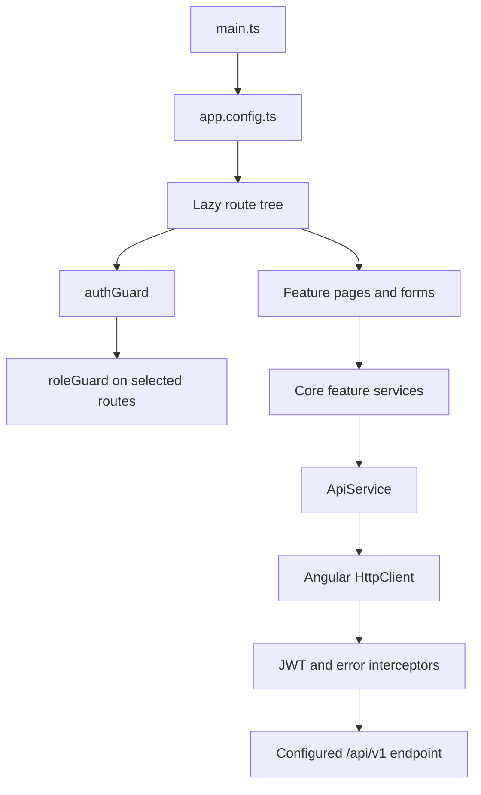

# Admin application architecture (as observed)

**Evidence status:** Static Angular source inspection; no build or runtime check.

## Bootstrap and routing

`src/main.ts` calls `bootstrapApplication(App, appConfig)`. `app.config.ts` provides zoneless change detection, Angular Router, and `HttpClient` with the JWT and error interceptors.

`app.routes.ts` defines lazy-loaded standalone page components. The login route is outside the protected layout. Other routes nest under the main layout and `authGuard`; selected feature routes add `roleGuard` metadata. The guards gate client navigation only; backend handlers enforce API permissions separately.

**Diagram basis:** The bootstrap/configuration files, `app.routes.ts`, core service inventory and interceptor registration.

## Client state and API access

- `AuthService` handles admin login, logout, refresh, and `/auth/me`.
- `authStore` uses Angular signals for access token, refresh token, user and role state. It initializes/persists tokens in browser `localStorage`.
- `jwtInterceptor` adds an authorization header when a token exists. `errorInterceptor` attempts a refresh and retries eligible 401 requests; on refresh failure it clears auth and navigates to login. It also shows user-facing toasts for 403, 404, and server errors.
- `ApiService` combines `environment.apiUrl` with feature paths, builds query parameters, and provides HTTP verbs. Its `list()` normalizer requires a `data` array and pagination metadata.
- Feature services under `src/app/core/services/` organize API calls for members, families, trainers, programs, batches, sessions, attendance, enrollments, payments, groups, notifications and activity logs.

## Feature boundaries

The route tree includes dashboard, member/family management, academic management, payments, groups, notifications, reports and audit logs. Pages are generally lazy-loaded from `src/app/features/`; route names do not prove every screen can complete its intended API workflow.

Phase 02 static tracing found contract gaps that affect this architecture's client/API edge: program field/enum and update-verb mismatch; batch membership path and list-shape issues; attendance payload and session-lock path mismatches; enrollment cancellation path mismatch; payment and notification payload/list mismatches; report URLs without matching backend routes; and audit-log field/filter mismatch. See the [integration architecture](./integration-architecture.md) for a concise cross-app matrix.

## Evidence

- [Bootstrap](../../kcdf-admin-app/src/main.ts), [provider setup](../../kcdf-admin-app/src/app/app.config.ts), [routes](../../kcdf-admin-app/src/app/app.routes.ts)
- [Auth service](../../kcdf-admin-app/src/app/core/services/auth.service.ts), [auth store](../../kcdf-admin-app/src/app/core/store/auth.store.ts), [auth guard](../../kcdf-admin-app/src/app/core/guards/auth.guard.ts), [role guard](../../kcdf-admin-app/src/app/core/guards/role.guard.ts)
- [API service](../../kcdf-admin-app/src/app/core/services/api.service.ts), [JWT interceptor](../../kcdf-admin-app/src/app/core/interceptors/jwt.interceptor.ts), [error interceptor](../../kcdf-admin-app/src/app/core/interceptors/error.interceptor.ts)
- [Development environment](../../kcdf-admin-app/src/environments/environment.ts), [production environment](../../kcdf-admin-app/src/environments/environment.prod.ts)

## Unverified

The configured production URL, user/browser behavior, route accessibility in a live deployment, API success rates, and actual user role assignments were not verified.
