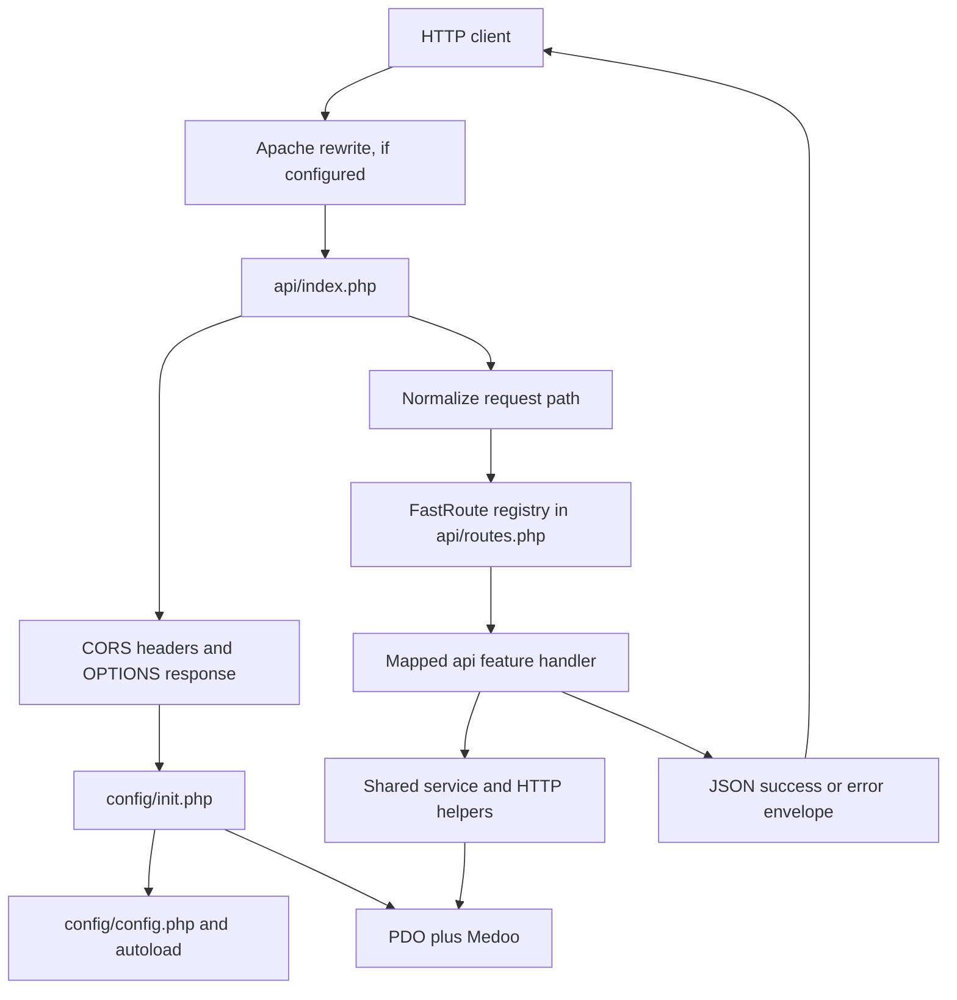

# Backend architecture (as observed)

**Evidence status:** Static source inspection. No endpoint, deployment, or database runtime was exercised.

## Request lifecycle

**Diagram basis:** `api/index.php`, `config/init.php`, `config/config.php`, `api/routes.php`, and `http/helpers.php`. The Apache edge is conditional on the repository `.htaccess` and host configuration; deployment was not tested.

## Observed layers

1. **Entry and dispatch:** `api/index.php` loads configuration to apply CORS headers and return early for `OPTIONS`; then it loads runtime initialization, normalizes the request path, creates a FastRoute dispatcher from `api/routes.php`, and includes the matching endpoint file. Unknown paths return JSON 404; known paths with unsupported verbs return JSON 405 and an `Allow` header.
2. **Runtime composition:** `config/init.php` requires configuration and the manual class autoloader, loads shared auth/identity/HTTP/logger files, validates JWT configuration, and creates a PDO connection and Medoo wrapper around that PDO instance. PDO exception mode, associative fetches, and native prepares are configured.
3. **Route registry:** `api/routes.php` maps HTTP method/path pairs to endpoint files. Resource handlers may handle multiple operations; group posts/polls/events share `groups/resources.php`.
4. **Endpoint handlers:** `api/<feature>/*.php` files read request data, perform route-specific authentication, authorization, validation and database operations, then return JSON.
5. **Shared services:** `services/auth.php` handles JWT operations; `services/identity.php` contains identity/role/data-access helpers and activity logging; academic, payment, and community helpers are separated into their respective service files.
6. **HTTP helpers:** `http/helpers.php` defines JSON body parsing, route parameter access, path normalization, response envelopes, and exception translation.

The manual autoloader maps bundled libraries including FastRoute, Firebase JWT, Medoo, Monolog, PSR Log, Respect Validation, and Symfony's mbstring polyfill. The repository does not establish a running dependency set.

## Authentication and failure handling

There is no global authentication check in the front controller. Each endpoint decides whether to call `checkAuth()` and which permission helpers apply. `checkAuth()` validates bearer JWTs, token type, portal/account claims, and member profile identifiers; authorization and record ownership checks live in endpoint/shared domain code.

`errorResponse()` returns `{success:false,error:{code,message,details?}}`; successful handlers use JSON success helpers. The front controller handles startup failures, missing handlers, not-found/method-not-allowed paths, and endpoint exceptions. `handleException()` maps selected domain exceptions and database failures to API errors and logs unexpected failures without returning exception details to the client.

## Configuration and deployment boundary

`config/config.php` reads environment variables and optionally parses the backend-root `.env` file. `config/init.php` validates the JWT setup and enforces required database settings for production mode. Configuration presence is not evidence that the file exists or that the values are appropriate; secret values were not inspected.

The backend `.htaccess` blocks direct access to private directories and direct PHP endpoint URLs, and rewrites `/api/v1` to the front controller. This only describes repository rules; Apache rewrite behavior depends on deployment configuration.

## Evidence

- [Front controller](../../api-backend-php/api/index.php), [registry](../../api-backend-php/api/routes.php), [bootstrap](../../api-backend-php/config/init.php), [autoload](../../api-backend-php/config/autoload.php), [configuration loader](../../api-backend-php/config/config.php)
- [HTTP helpers](../../api-backend-php/http/helpers.php), [JWT/auth helpers](../../api-backend-php/services/auth.php), [identity helpers](../../api-backend-php/services/identity.php), [rewrite/access rules](../../api-backend-php/.htaccess)
- Domain-specific evidence: [academic services](../../api-backend-php/services/academics.php), [payment services](../../api-backend-php/services/payments.php), [community services](../../api-backend-php/services/community-notifications.php)

## Unverified

No HTTP checks, PHP CLI commands, test suite, host configuration, logs, database connectivity, or deployed route behavior were checked. The PHP deployment guide describes a candidate replacement runtime; production cutover is not asserted.
