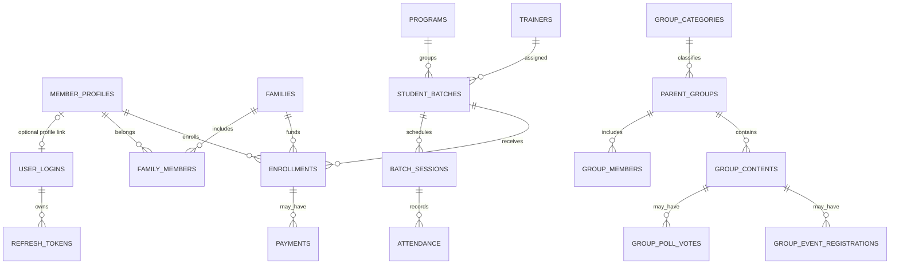

# Database architecture (schema-defined)

**Evidence status:** Static review of `api-backend-php/database/schema.sql` and the migration files. No live database was queried and no migration was run.

## Data domains

The checked schema defines 25 tables in four related groups:

| Domain | Tables |
|---|---|
| Identity, family and entities | `addresses`, `member_profiles`, `user_logins`, `refresh_tokens`, `families`, `family_members`, `entities`, `entity_member_relations`, `invitations` |
| Academic participation | `trainers`, `programs`, `student_batches`, `batch_members`, `batch_sessions`, `attendance`, `enrollments` |
| Groups and content | `group_categories`, `parent_groups`, `group_members`, `group_contents`, `group_poll_votes`, `group_event_registrations` |
| Payments, communications and audit | `payments`, `notifications`, `activity_logs` |

## Principal relationships

**Diagram basis:** Foreign-key declarations in `schema.sql`. It omits secondary links for readability and does not imply live data. Some schema relationships are optional; the full DDL is authoritative for nullability and constraints.

## Key modeling observations

- Person data is centered on `member_profiles`; `user_logins.profile_id` is nullable and unique, supporting logins without a linked person profile. `refresh_tokens` references login and profile IDs and stores token hashes and lifecycle timestamps.
- `families` may reference an `addresses` row. `family_members` joins families and profiles with relationship/role/status attributes.
- Programs contain batches; batches connect trainers, members, sessions, and enrollments. Attendance references a session and member, and records the marking member.
- Enrollment references family/member/batch and snapshots participation/payment fields. `payments` references a family and optionally an enrollment.
- Group content uses one `group_contents` table with a content type; poll votes and event registrations are separate child tables with unique content/member relations.
- `notifications` references a member profile. `activity_logs` stores actor/entity identifiers and old/new values; the actor identifier is not declared as a foreign key in the inspected schema.
- Entity/profile relationships use `entity_member_relations`; invitations reference their inviter profile.

## Schema and migration boundary

Phase 02 identified five migrations: login/account type changes, address subdivisions, group categories/roles, group content, and optional group display name/owner. Their contents record intended schema changes only. Application state, migration ordering in deployment, data integrity in a live database, backups, and schema compatibility are unverified.

## Evidence

- [Schema](../../api-backend-php/database/schema.sql)
- `api-backend-php/database/migrations/20261010_user_login_types.sql`
- `api-backend-php/database/migrations/20261018_add_taluk_village_to_addresses.sql`
- `api-backend-php/database/migrations/20261020_group_categories_roles.sql`
- `api-backend-php/database/migrations/20261023_group_content.sql`
- `api-backend-php/database/migrations/20261024_group_display_name_optional_owner.sql`

## Unverified

No production database connection, migration status, row counts, data quality, or runtime transaction behavior was checked. The diagram is a reading aid, not a replacement for the schema DDL.
