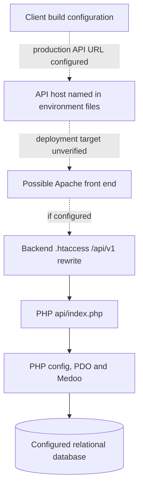

# Deployment architecture (repository evidence only)

**Evidence status:** Repository configuration and deployment-document review only. No live environment, host, release, or deployment process was inspected.

## Backend deployment surface

The PHP repository contains an `.htaccess` intended for Apache. It disables directory listings, forwards the authorization header, denies direct access to private backend directories and endpoint PHP files, and rewrites `/api/v1` requests to `api/index.php`. The backend deployment guide recommends an Apache document root at the backend directory and names Apache rewrite support, PHP/PDO extensions, MySQL, writable storage/log paths, and environment configuration as deployment requirements.

These are repository instructions, not proof that the server uses Apache or that the directives and permissions are active.

## Client configuration

Both client production environment files set the API URL to `https://api.kcdfindia.com/api/v1`; development files point to a local path under `kcdf-parents/api-backend-php`. These values do not establish where a release was built, what host serves it, or which API implementation is deployed.

## Cutover and operational status

`api-backend-php/DEPLOYMENT.md` describes the PHP runtime as a candidate replacement for the Slim API, not as production-ready. It identifies staging acceptance, feature tests, and consumer integration as cutover gates and says to retain the Slim deployment as rollback until acceptance. Its operational caveats include unverified Apache behavior, PHP extensions, environment injection, log permissions, CORS and database driver.

Other repository deployment guides are procedural documents and are not evidence of an actual release. CI deployment workflows were not examined; hosting configuration, runtime logs, server inventory, secret store, monitoring configuration, backup execution, and rollback events were not verified in this phase.

## Deployment evidence map

| Surface | Evidence and interpretation |
|---|---|
| API entry | `api-backend-php/api/index.php`; front controller in source. |
| Rewrite/access rules | `api-backend-php/.htaccess`; intended Apache behavior, host-dependent. |
| Backend settings | `api-backend-php/config/config.php`; environment-driven configuration; secret values not read. |
| API deployment/cutover | `api-backend-php/DEPLOYMENT.md`; candidate-runtime instructions and acceptance gates, not deployment confirmation. |
| Client API targets | `kcdf-admin-app/src/environments/*` and `kcdf-parents-app/src/environments/*`; build-time URL declarations only. |
| Supplemental guidance | Archived [`hestiacp-deployment.md`](../../_archive/pending-deletion/docs/deployment/hestiacp-deployment.md) and [`DEPLOYMENT_GUIDE.md`](../../_archive/pending-deletion/devdocs/DEPLOYMENT_GUIDE.md); documentation content, not host state. |

**Diagram basis:** Source environment files, `.htaccess`, backend configuration and deployment guide. Dashed edges emphasize that no live host or runtime was observed.

## STOP / unknowns

The active API runtime, server topology, domains, installed versions, database state, credentials, TLS, release pipeline, backup/monitoring processes and production readiness remain unverified. No deployment, build, migration or operational command was run.
