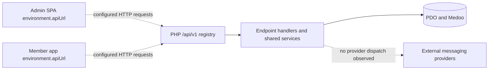

# Integration architecture (as observed)

**Evidence status:** Static client, route, handler, schema and API-contract review. No request was sent and no external service was tested.

## Client-to-API configuration

Both Angular applications configure the same versioned API base path in their checked environment files:

| Client | Development value | Production value |
|---|---|---|
| Admin | `http://localhost/kcdf-parents/api-backend-php/api/v1` | `https://api.kcdfindia.com/api/v1` |
| Member | `http://localhost/kcdf-parents/api-backend-php/api/v1` | `https://api.kcdfindia.com/api/v1` |

These are source configuration values, not proof of a running backend, DNS, TLS, or deployed code version. The PHP deployment guide identifies the plain-PHP runtime as a candidate replacement for Slim and says cutover remains subject to staging acceptance and consumer integration.

**Diagram basis:** Environment files, `api/routes.php`, backend services and schema. Dashed arrows denote configuration or a reviewed-but-unverified boundary. The last edge records that external notification delivery was not found in the traced handlers; it does not assert no provider exists elsewhere.

## Observed client/API relationships

| Area | Source relationship |
|---|---|
| Admin authentication | Calls `/auth/admin/login`, `/auth/refresh`, `/auth/logout` and `/auth/me`; routes exist in PHP. |
| Admin identity/family | Member/family services and pages call corresponding PHP paths. Invitation, entity and admin-account endpoints have no consumer found in the bounded client inventory. |
| Admin academics | Services call program, batch, trainer, session, attendance and enrollment routes; static contract mismatches exist for update verbs, fields, batch-member mutation, attendance payload, session lock and enrollment cancellation. |
| Admin groups | Group service and screens connect to group and content APIs. Group content/poll/event routes exist in PHP but are absent from the checked OpenAPI document. |
| Admin payment/notification | PHP route groups exist, but form/list payloads, fields, paths and filters diverge as recorded in Phase 02. Backend notification handlers persist notification rows; provider delivery was not evidenced. |
| Admin reports | Attendance, enrollment and payment pages call `/reports/...`; no corresponding PHP route/handler or checked OpenAPI path was found. |
| Member profile/family | The profile and family pages call corresponding PHP APIs. |
| Member groups | Group list/detail methods call PHP group/content endpoints; group content is stored in shared content tables. |
| Member courses/posts | Course pages and standalone home/posts screens use sample constants. Program/batch service methods exist, but course pages had no call sites in the bounded review. |

## Contracts and integrations

`api-backend-php/swagger/openapi.json` documents many auth, identity, academic, payment, notification and activity routes. The checked contract omits group content/poll/event operations and report URLs. OpenAPI presence and client configuration do not demonstrate successful interoperability.

The traced notification handlers write to the `notifications` table but do not show provider SDK calls, delivery callbacks or outbound transport. No external identity, payment gateway, email, push, SMS or analytics integration was established in the inspected paths.

## Evidence

- [Admin environments](../../kcdf-admin-app/src/environments/environment.ts), [admin production environment](../../kcdf-admin-app/src/environments/environment.prod.ts)
- [Member environments](../../kcdf-parents-app/src/environments/environment.ts), [member production environment](../../kcdf-parents-app/src/environments/environment.prod.ts)
- [PHP registry](../../api-backend-php/api/routes.php), [OpenAPI document](../../api-backend-php/swagger/openapi.json), [backend cutover notes](../../api-backend-php/DEPLOYMENT.md)
- Detailed client/server evidence is cited in the direct source links above and in the area-specific table.

## Unverified

Actual deployed API target, live CORS allowlist, endpoint success, OpenAPI publication, external notification delivery, and integrations outside the bounded source paths were not verified.
