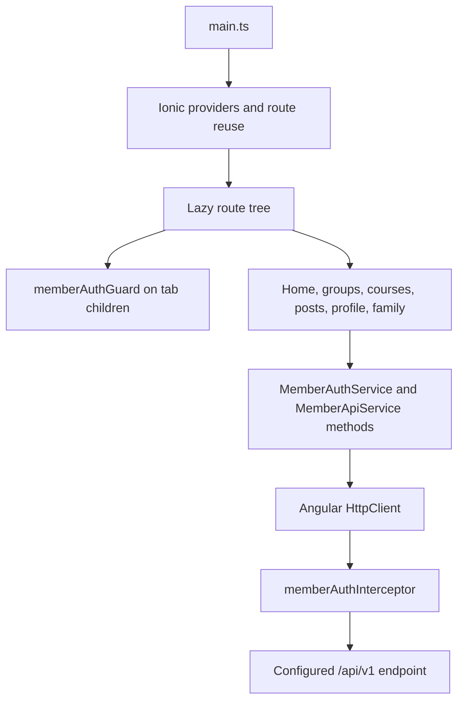

# Member application architecture (as observed)

**Evidence status:** Static Ionic/Angular source inspection; no build or runtime check.

## Bootstrap and route tree

`src/main.ts` bootstraps the standalone `AppComponent`, provides Ionic Angular, uses `IonicRouteStrategy`, configures Angular Router with preloading, and registers `memberAuthInterceptor`. `app.routes.ts` lazy-loads login and tab pages. The tabs route applies `memberAuthGuard` to child routes for home, groups, courses, posts, profile and family.

**Diagram basis:** `main.ts`, `app.routes.ts`, and `core/member-auth.service.ts`; it is a source-level call structure, not a successful runtime trace.

## Session, API and page behavior

- `MemberSessionStore` holds access token, refresh token and profile in signals backed by browser `localStorage`. Its authentication check decodes token expiry locally.
- `MemberAuthService` calls `/auth/login` and `/auth/logout`; `memberAuthInterceptor` attaches the access token to API requests.
- The server exposes refresh-token endpoints, and the member client stores a refresh token, but the inspected member service has no refresh method or automatic refresh/retry flow. Do not equate stored refresh token with implemented automatic renewal.
- The member service also declares profile/family, group content, poll/event, program and batch API methods. The profile/family and group-detail flows are source-connected. Program/batch methods were not found to be called by the course pages in the bounded source review.
- The courses pages read `SAMPLE_COURSES`; home and standalone posts screens read `SAMPLE_POSTS`. Those screens are sample-backed and are distinct from the group-detail announcement/poll/event requests.

## Evidence

- [Bootstrap](../../kcdf-parents-app/src/main.ts), [routes](../../kcdf-parents-app/src/app/app.routes.ts), [session and API service](../../kcdf-parents-app/src/app/core/member-auth.service.ts)
- [Sample content](../../kcdf-parents-app/src/app/core/sample-content.ts), [development environment](../../kcdf-parents-app/src/environments/environment.ts), [production environment](../../kcdf-parents-app/src/environments/environment.prod.ts)
- Related backend mapping: [routes](../../api-backend-php/api/routes.php), [group resource handler](../../api-backend-php/api/groups/resources.php)

## Unverified

No member login, refresh, navigation, HTTP request, or deployed API interaction was executed. External consumption of member API operations not called by current pages is unknown.
