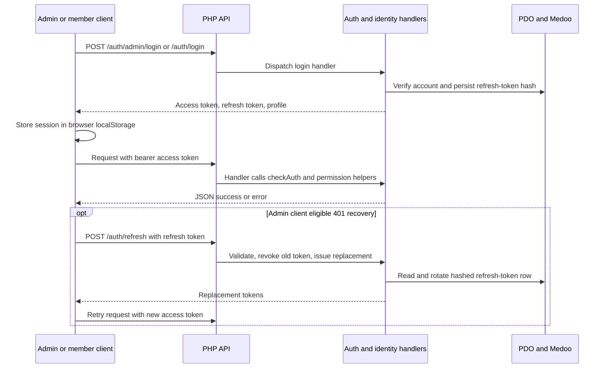

# Security architecture (source-observed controls)

**Evidence status:** This is an architectural summary of static controls, not a security audit or assurance statement. No runtime tests were run.

## Authentication and tokens

The backend has separate member and admin login routes. `services/auth.php` validates JWT configuration at startup, permits the configured HMAC algorithm from its allowlist, validates bearer tokens, and distinguishes access from refresh tokens. `services/identity.php` and the auth handlers add portal/account type and role data to login context.

Refresh tokens are represented by hashed values in `refresh_tokens`. The refresh handler validates token/account state, revokes the presented token and issues a replacement in a transaction. The logout handler revokes the matching refresh token. These are source-observed operations; expiration/revocation behavior was not runtime-tested.

**Diagram basis:** `api/routes.php`, `api/auth/` handlers, `services/auth.php`, `services/identity.php`, the admin auth service/error interceptor and member auth service. The optional retry is specific to the inspected admin client; the member app has no automatic refresh flow in the inspected implementation.

## Authorization boundaries

- There is no global auth gate in `api/index.php`. Each endpoint invokes `checkAuth()` and role/resource helpers as needed.
- Shared identity helpers include portal-aware role filtering, admin/elevated-admin checks, member/family access checks, and permission errors. Academic, payment and group services add domain-specific access checks.
- Route guards in the Angular admin and member apps control navigation and improve UX. They are not substitutes for backend authorization.
- The backend checks resource ownership and family/group/batch relationships in relevant handlers. Intended business policy is not established by code alone.

## Additional controls observed

- `config/config.php` supports environment-based settings, CORS allowlisting and a backend-root `.env` file. Secret values were not read or copied.
- `api/index.php` handles preflight and applies CORS response headers for configured origins.
- `api-backend-php/.htaccess` denies direct access to private directories and direct endpoint PHP files, and routes versioned API requests through the front controller. This depends on Apache configuration.
- `http/helpers.php` returns structured errors and avoids exposing unexpected exception details in the JSON 500 response; unexpected failures are logged.
- The admin and member clients store tokens in browser `localStorage`. This is a source observation, not an assessment of deployed browser protections.

## Boundaries and gaps

- `checkAuth()` validates token claims but does not itself query the current login status. The Phase 02 trace found `/auth/me` and refresh perform current-account checks, while other handlers may rely on token validation alone; behavior after account deactivation is unverified.
- Role distinctions, including readonly behavior and family/member edit rules, reflect implementation rather than approved policy.
- Password requirements differ across admin account creation, member login creation and invitation acceptance in the inspected handlers; intended policy is unresolved.
- No complete endpoint authorization audit, penetration test, dependency audit, browser storage assessment, CORS deployment check, or secret-management verification was performed.

## Evidence

- [JWT helpers](../../api-backend-php/services/auth.php), [identity/permission helpers](../../api-backend-php/services/identity.php), [route dispatch](../../api-backend-php/api/index.php)
- [Configuration](../../api-backend-php/config/config.php), [runtime bootstrap](../../api-backend-php/config/init.php), [HTTP/error helpers](../../api-backend-php/http/helpers.php), [access rules](../../api-backend-php/.htaccess)
- Client controls: [admin guards](../../kcdf-admin-app/src/app/core/guards/auth.guard.ts), [admin role guard](../../kcdf-admin-app/src/app/core/guards/role.guard.ts), [member session/guard](../../kcdf-parents-app/src/app/core/member-auth.service.ts)
- Related source evidence is in `api-backend-php/api/auth/`, `api-backend-php/api/members/`, `api-backend-php/api/families/`, and the shared auth/identity files cited above.
