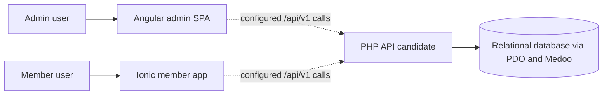

# System architecture (as observed)

**Evidence status:** Pass 1 static source reconstruction. This document describes repository evidence, not a deployed system or target design.

## Context and boundaries

The repository contains three application areas: a PHP API, an Angular administration SPA, and an Ionic/Angular member application. Both client projects configure an `/api/v1` base URL. The PHP backend contains a single API front controller, route registry, endpoint files, shared services, and a relational schema.

The PHP deployment guide explicitly calls this runtime a candidate replacement for a Slim API and says production cutover depends on staging acceptance and consumer integration. Therefore, the configured client URLs do not establish that this PHP runtime is currently serving production traffic.

**Diagram basis:** Client base URLs are observed in each app's environment files; the API-to-database connection is observed in `config/init.php`. Dashed client edges mean configured/source-level relationships only. Deployment, reachability, and database state are unverified. No external provider integration was established in the inspected request paths.

## Component responsibilities

| Component | Source-observed responsibility | Limits |
|---|---|---|
| PHP API | CORS/preflight, path normalization, FastRoute dispatch, endpoint inclusion, JSON errors/responses, shared identity/domain helpers and database access. | No global authentication gate; individual handlers enforce their own checks. Runtime behavior is unverified. |
| Admin SPA | Authenticated operations and management views for members, families, programs, groups, payments, notifications and reports. | Several client request/response contracts diverge from PHP routes or handlers; see [integration architecture](./integration-architecture.md). |
| Member app | Login/session, profile/family views, groups and group content. | Courses and standalone posts/home feed use sample content; not all service methods are called by a page. |
| Database schema | Relational definitions for identities, families, academic participation, groups/content, payments, notifications and activity logs. | The schema file does not establish a deployed database or migration state. |

## Representative source-backed flows

### Admin authentication and API request

1. The admin login page calls `/auth/admin/login` through `AuthService`.
2. The PHP route registry maps that path to `api/auth/admin-login.php`.
3. The handler authenticates the portal account and issues access/refresh tokens using the identity/auth services.
4. The Angular auth store persists tokens in browser `localStorage`; the JWT interceptor attaches the access token to requests. The error interceptor attempts refresh and retries eligible 401 responses.
5. Subsequent requests are dispatched by the PHP front controller; each protected handler applies its own auth and permission checks.

This is a source trace only. It does not show a live request or establish that every admin page/API contract succeeds.

### Member group content

1. The authenticated group pages use `MemberApiService` methods in `member-auth.service.ts`.
2. Group content requests use `/groups/{group_id}/posts`, `/polls` or `/events`.
3. `api/routes.php` dispatches these resource patterns to `api/groups/resources.php`.
4. The handler stores content in `group_contents`; poll votes and event registrations use their related tables.

The separate member home/posts feed uses `SAMPLE_POSTS` and is not the same source path as group announcements.

## Architectural gaps and confidence

- **Observed:** Backend routes include groups, polls, events and data handlers; the checked OpenAPI document omits group-content operations.
- **Observed:** Admin report pages call report URLs for which no route/handler was found in the checked PHP registry; runtime behavior is not tested.
- **Observed:** Payment, program, attendance and notification clients have documented request/response mismatches in the Phase 02 source trace.
- **Unverified:** Which API runtime is deployed, whether the PHP candidate has passed staging, external service configuration, actual traffic, and live database/migration state.
- **Not inferred:** Missing client pages or endpoint documentation are not interpreted as product requirements.

## Evidence

- [API front controller](../../api-backend-php/api/index.php), [route registry](../../api-backend-php/api/routes.php), [runtime composition](../../api-backend-php/config/init.php)
- [Admin bootstrap](../../kcdf-admin-app/src/main.ts), [admin routes](../../kcdf-admin-app/src/app/app.routes.ts), [admin development URL](../../kcdf-admin-app/src/environments/environment.ts), [admin production URL](../../kcdf-admin-app/src/environments/environment.prod.ts)
- [Member bootstrap](../../kcdf-parents-app/src/main.ts), [member routes](../../kcdf-parents-app/src/app/app.routes.ts), [member service/session](../../kcdf-parents-app/src/app/core/member-auth.service.ts), [member sample content](../../kcdf-parents-app/src/app/core/sample-content.ts)
- [Database schema](../../api-backend-php/database/schema.sql), [backend deployment and cutover notes](../../api-backend-php/DEPLOYMENT.md)
- The feature-level flow statements above were checked against the cited current PHP, Angular, Ionic and schema sources; this permanent document does not rely on workflow-only analysis files.
